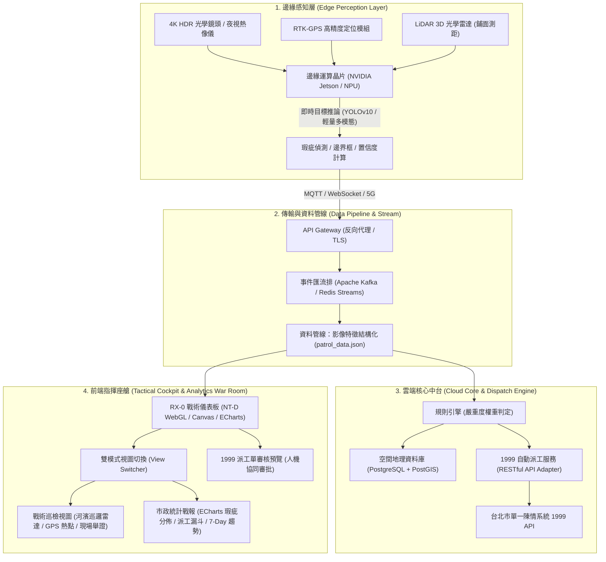
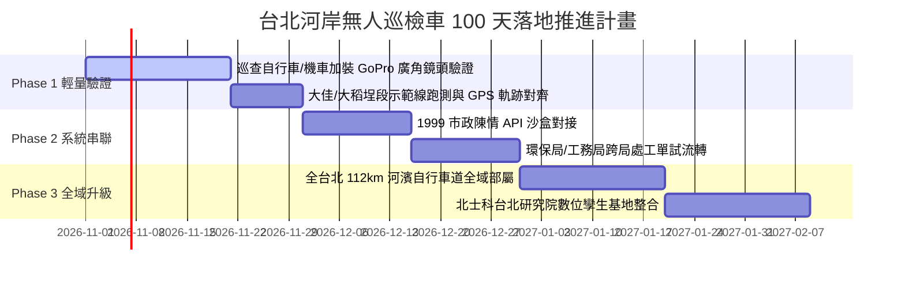

# RX-0 TAIPEI DEBUGGER // 台北河岸無人巡檢智慧治理系統
## 系統規劃書（System Architecture & Implementation Proposal）

> **專案代號**：`RX-0 TAIPEI DEBUGGER // NT-D SYSTEM`  
> **提案主題**：2026 台北市政黑客松（Taipei Civic Debugathon）× 台北研究院先導概念驗證  
> **提案作者**：雲端架構 / 全端工程師（資管研究所）  
> **展示原型**：[RX-0 台北河岸無人巡檢車駕駛艙 (Cockpit Prototype)](./index.html)  
> **雲端展示站**：[https://gundam_uc.lab.pengucat.com/](https://gundam_uc.lab.pengucat.com/)  
> **版本**：v1.2 (2026.10)

---

## Executive Summary 執行摘要

台北市境內擁有長達 **112 公里** 的河濱自行車道與廣闊的高灘地公園，承載著大量市民休閒、觀光運動與城市防汛機能。然而，現行市政查報多半依賴「市民 1999 電話陳情」或「公務巡查員肉眼抽查」，存在**通報時滯長（平均 24~48 小時）、盲區廣、照片佐證不足、局處跨部門派工踢皮球**等結構性問題。

本企劃提出 **「RX-0 TAIPEI DEBUGGER」無人巡檢智慧治理系統**：
將市政除錯（Civic Debugging）由**被動陳情**扭轉為**主動巡檢**。透過巡邏載具外掛 AI 視覺感知邊緣端，沿淡水河、基隆河水岸主動掃描安全隱患；後端以事件驅動（EDA）架構無縫串聯「1999 自動派工閉環」，並在市府成立 100 天內以低成本快速落地，更可無縫銜接未來於北士科籌設的「台北研究院」前瞻數位治理研發體系。

---

## 一、 核心痛點與政策指標對接（沈伯洋市政藍圖）

本系統直接對接台北市政核心指標，針對四大痛點提供高精準度的 AI 識別與數位工單流：

| 政策指標 | 市政痛點現況 | RX-0 AI 巡檢辨識標的 | 權責派工局處 | 處置時效目標 |
| :--- | :--- | :--- | :--- | :--- |
| **#02 找回消失的垃圾桶** | 河岸夜間/假日垃圾桶滿溢，廢棄物溢流落地，甚至遭違規棄置家戶垃圾，影響水岸市容。 | 垃圾桶滿溢容積比率估算（>80%）、垃圾包散落面積、違規大型廢棄物。 | 環境保護局（清潔隊 / 環保稽查大隊） | **2 小時內** 派員清運換膽 |
| **#07 步道安全除錯 (Bug)** | 透水地磚碎裂、沉陷積水、夜間反光標線磨損、安全護欄螺栓鬆脫，威脅單車與行人安全。 | 地面坑洞幾何檢測、鋪面龜裂等級、標線連續度、護欄變形傾斜。 | 工務局水利工程處（河川工程科 / 工務科） | **48 小時內** 完成冷補排程 |
| **#01 把三千棵樹種回來** | 強風豪雨後老樹傾倒壓傷行人、白千層/苦楝等高灘地路樹遭受褐根病真菌侵襲、樹穴缺損。 | 樹幹傾斜角度（>15°）、病斑真菌冠幅辨識、空樹穴 GPS 建檔。 | 工務局公園路燈工程管理處（園藝隊 / 樹醫小組） | **緊急 4 小時** 支撐扶正 / 樹木身分證建檔 |
| **#03 鼠患衛生死角治理** | 大稻埕等水岸碼頭餐飲散場後溝鼠出沒、死角草叢堆置引來孑孓孳生登革熱。 | 熱像/夜視微小動態追蹤、死角廢棄物熱點疊圖分析。 | 衛生局疾病管制科 / 環保局消毒班 | **24 小時內** 投放藥劑熱煙霧消毒 |

---

## 二、 總體系統架構設計（雲端架構師視點）

本系統採 **邊緣邊際推論（Edge AI）+ 雲端事件驅動（Cloud EDA）+ 現代化戰術駕駛艙（NT-D Cockpit）** 的三層解耦架構，具備高延展性與極低延遲特質。



### 1. 邊緣感知層 (Edge Layer)
- **硬體輕量適配與 GPS 坐標對齊策略**：
  - **初期驗證（Phase 1）**：以現有河濱巡查員之自行車／公務機車，龍頭加裝 **4K 廣角運動相機（如 GoPro / 行車記錄器）**。利用相機內建 18Hz 之 **GPMF 遙測軌道（Telemetry Metadata Track）**，將錄影影格時間戳（Frame Timestamp）與經緯度軌跡進行毫秒級線性插值對齊，以極低成本達成零死角的瑕疵坐標定位。
  - **超廣角（Wide 120°）視角覆蓋**：以河濱車道 3~4 公尺寬度，單鏡頭即可 100% 涵蓋鋪面坑洞、左側行道樹木與右側水岸垃圾箱。
  - **進階演進（Phase 2/3）**：逐步升級為掛載於小型無人巡檢車（Rover）與無人機之專用邊緣運算晶片（NVIDIA Jetson / NPU）與 RTK-GPS 模組。
- **推論管線**：在設備端或回傳後端以 YOLO 視覺模型離線分析，免除將全時 4K 高畫質影像持續回傳雲端的高昂頻寬費用，**僅於識別出異常隱患時擷取 500KB 關鍵影格（Snapshot）與遙測資料**。

### 2. 資料交換規格 (`patrol_data.json`)
邊緣端生成之標準事件 JSON 資料結構：
```json
{
  "incident_id": "TPE-2026-0891",
  "timestamp": "2026-10-14T01:15:30.000Z",
  "policy_tag": "#02 找回消失的垃圾桶",
  "category": "trash",
  "severity": "HIGH",
  "confidence": 0.948,
  "gps": {
    "latitude": 25.04892,
    "longitude": 121.57124,
    "heading": 72.0,
    "sector": "dajia"
  },
  "snapshot_url": "https://cdn.tpe-debugger.gov.tw/snaps/20261014_0891.jpg",
  "suggested_department": "台北市政府環境保護局",
  "recommended_action": "調派大同清潔隊攜帶替換內膽前往清運，加強違規棄置稽查",
  "policy_100d_meta": "市府上任 100 天現有巡邏車加裝 AI 邊緣鏡頭快速布建計畫"
}
```

### 3. 指揮座艙（NT-D 戰術駕駛艙與市政戰報）
- **沉浸式儀表板**：引入鋼彈 UC 獨角獸 NT-D（Newtype Drive）毀滅模式概念，提供操作員宛如機甲座艙的高專注介面。
- **雙模式戰術導覽（HUD View Switcher）**：
  - **戰術巡檢視圖**：即時呈現河濱路線熱點地圖、現場 AI 截圖舉證、遙測數據與待派工工單列表。
  - **市政統計戰報（Apache ECharts）**：為工務局長與跨局處主管提供數據戰情室，展示異常分類甜甜圈圖、1999 派工進度漏斗、四大河段修復堆疊圖與近期收斂趨勢。
- **人機協同審批（Human-in-the-Loop）**：巡檢自動觸發警報，操作員一鍵預覽並直接拋轉至 1999 工單系統。

---

## 三、 黑客松展示策略（Demo & Execution Plan）

針對 10/23 預先準備與 10/24 現場評審 Demo，採取「雙階段解耦」實戰策略：

```
【第一階段：離線/雲端完成】          【第二階段：現場展示流】
實拍水岸影片 (.mp4)               即時載入 patrol_data.json
       │                                     │
       ▼                                     ▼
Python YOLOv10 推論腳本         ─────▶  RX-0 戰術駕駛艙 (NT-D 啟動)
       │                                     │
       ▼                                     ▼
產出 patrol_data.json 結構檔            即時雷達 + 影像鎖定 + 1999 派工 + ECharts 統計
```

### 階段 1：影片 ➔ Data JSON（23 號前完成）
1. **影像採集**：先行以 GoPro / 行車記錄器錄製台北河岸（大佳、大稻埕、彩虹、關渡）白天與夜間實拍影片。
2. **特徵提取**：透過本機 Python 腳本完成目標辨識與 GPS 軌跡時間戳對齊，將座標與違規影像預先封裝為高品質的 `data.js` 樣本庫，確保 Demo 現場不受網路頻寬斷線風險干擾。

### 階段 2：Data JSON ➔ Dashboard 互動展示（24 號現場展示）
1. **開場震撼儀式**：
   - 瀏覽器打開駕駛艙，全螢幕待命畫面。
   - 點擊按鈕觸發 **澤野弘之《UNICORN》BGM** 與 **高密度紫色火焰等化器光條**，歷經 10 秒超頻倒數進入主控台。
2. **動態巡檢演繹**：
   - 即時切換大佳、大稻埕、彩虹、關渡四條巡檢路線，左側雷達座標與航向角即時連動。
   - 中央攝影機視角模擬車載前鏡頭，展示動態捕捉到「垃圾桶滿溢」、「地磚破損」之綠/紅鎖定框與現場 AI 舉證。
3. **戰情室 ECharts 統計切換**：
   - 一鍵切換至「📊 市政統計戰報」，向評審展示工務局 1999 派工漏斗、4 大河段處置進度與 MTTR 平均修復週期指標。
4. **一鍵派工閉環**：
   - 點擊任一事件卡片，彈出「1999 市政派工工單預覽」Modal。
   - 展示 AI 照片舉證、GPS 經緯度、權責局處派定，點擊「模擬傳送至 1999 系統」完成市政閉環。

---

## 四、 市府 100 天落地規劃（Roadmap）

針對市政團隊「快速見效、不浪費公帑、漸進升級」的治理要求，擬定上任 100 天三階段落地時程表：



- **Day 01 - 30（輕量驗證期：現有人力 + GoPro 廣角）**：
  - **零硬體採購負擔**：不需一開始購置昂貴自駕車，直接在水利處既有巡邏自行車／巡查機車龍頭夾裝 4K 廣角運動相機。
  - **被動式巡檢**：巡查員依照既有路線騎乘，後端自動抽取 GoPro 內建 GPMF 軌跡對齊影格，先行在大佳河濱與大稻埕碼頭完成路跑校正。
- **Day 31 - 60（系統串接期）**：
  - 完成與市府資訊局 1999 API Sandbox 介接，實施「AI 檢出 ➔ 清潔隊/工務所工單派發 ➔ 完工回傳核銷」的自動流轉。
  - 建立第一份「台北水岸鋪面與垃圾滿溢熱點地理圖資」。
- **Day 61 - 100（全域部署與台北研究院孵化）**：
  - 普及至全北市 112 公里河濱步道，實現「每日例行巡邏、當日回報派工」。
  - 正式納入北士科「台北研究院」智慧城市實驗室，發展下一代「陸空聯防（無人車 + 巡檢無人機）」自主避障巡弋演算法。

---

## 五、 與未來「北士科 台北研究院」之契機與人資銜接

### 1. 為何這是台北研究院的理想核心題目？
- **北士科地理優勢**：北投士林科技園區鄰近雙溪與基隆河交匯處，具有得天獨厚的「智慧水岸科技實證場域」。
- **跨領域研發價值**：無人車結合了**邊緣嵌入式系統、雲端微服務、地理空間大數據 (GIS)、都市韌性防災與市民互動 (Civic Tech)**，是台北研究院向市民與國際展示「科技治理落地」的最佳亮點櫥窗。

### 2. 提案工程師自我定位（資管研 × 雲端架構師）
- **專業技能矩陣**：
  - **雲端與分散式架構**：具備高可用（HA）、容器化（Docker/K8s）、事件驅動資料流（Kafka/MQTT）設計能力，確保成百上千台車載節點資料高併發回傳不掉封包。
  - **全端開發與資料視覺化**：具備現代 Web（Canvas/WebGL/Vue/React/WebSocket）即時儀表板建構力，能將複雜的遙測指標轉化為公務員易上手的友善介面。
  - **市政痛點理解與整合**：具備資管人「流程最佳化（BPR）」思維，理解政府跨局處行政流程，非單純炫技，而是為公務體系省人力、降風險。

---

## 六、 結論

「RX-0 TAIPEI DEBUGGER」不僅僅是一台無人車或一個帥氣的鋼彈風格介面，更是**台北市迈向「資料驅動智慧城市」的關鍵神經末梢**。透過低成本邊緣改裝、標準化 JSON 資料管線與閉環派工體系，讓台北的河岸變得更乾淨、更安全、更具科技未來感！

> **「當科技不是冰冷的口號，而是清晨大佳河濱被扶正的一棵樹、大稻埕碼頭及時清空的垃圾箱，這就是我們給台北最棒的 Debug 方案。」**

